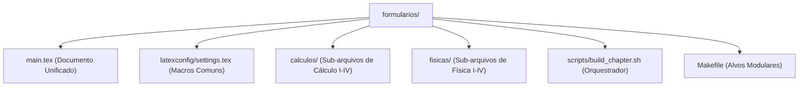

# DESIGN — Formulários Architecture & Design Rules

## 1. Estrutura Modular

---

## 2. Padrões de Design Tipográfico

1. **Equações e Notação:**
   - Todo capítulo usa o pacote `siunitx` para grandezas e unidades.
   - Constantes e variáveis devem manter consistência conceitual em todo o compêndio.
2. **Isolamento de Compilação:**
   - Cada pasta de disciplina contém um arquivo `.tex` mestre próprio e arquivos por capítulo (`cap*.tex`), permitindo compilações granulares sem overhead.
